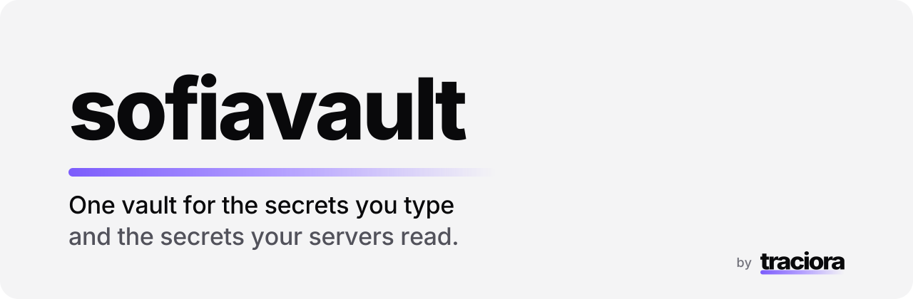
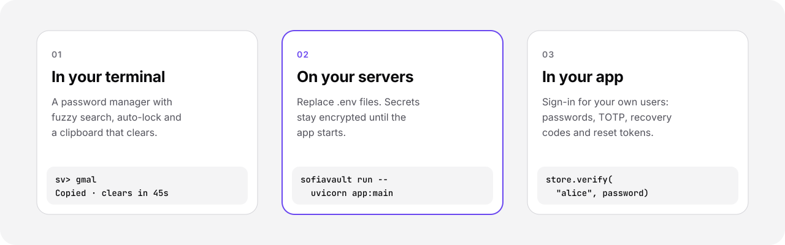

<picture>
  <source media="(prefers-color-scheme: dark)" srcset="docs/assets/hero-dark.svg">
  
</picture>

**SofiaVault keeps secrets encrypted everywhere they live: in your terminal, on your
servers and inside your app.**

Most teams have passwords in a password manager, sixty API keys in a plaintext `.env`
file, and user logins in a table they wrote themselves. SofiaVault replaces all three
with one small Python package and one encrypted file per job.

<picture>
  <source media="(prefers-color-scheme: dark)" srcset="docs/assets/flow-dark.svg">
  
</picture>

## What you get

- **Nothing in plain text.** Passwords *and* their names, usernames and URLs are encrypted.
  The database holds only ciphertext, and tampering with it is detected.
- **A terminal you'll actually use.** Type close enough and fuzzy search finds the entry.
  Passwords go to the clipboard and clear after 45 seconds. The session locks itself
  after 5 minutes.
- **No more `.env` files.** `sofiavault run -- your-app` starts your app with its secrets
  injected from the vault. An allowlist decides which names it may receive.
- **Ready for production.** Key files, Docker mounts, key rotation and a `doctor` check
  that tells you whether a deployment will boot.
- **Sign-in done right.** A user store that can never reveal a password, with TOTP,
  single-use recovery codes, reset tokens and migration from bcrypt without a mass reset.
- **Works everywhere.** macOS, Linux and Windows. Import from any password manager's CSV.

## Security

| | |
|---|---|
| Master key | Argon2id (64 MB memory, 3 iterations) |
| Per-entry keys | HKDF-SHA256 with a unique salt per entry |
| Encryption | AES-256-GCM, metadata included |
| Files | Vault directory 0700, database 0600 |

Details in [How it works](docs/how-it-works.md) and the threat model in [SECURITY.md](SECURITY.md).

## Quick start

Python 3.9 or newer.

```bash
git clone https://github.com/danilmezor/sofiavault.git && cd sofiavault
pip install .
sofiavault            # create your vault and start the interactive shell
```

For an app:

```bash
sofiavault env import .env                 # encrypt an existing .env once
sofiavault run -- uvicorn app:main         # start the app with its secrets
```

## Documentation

[Password manager](docs/password-manager.md) · [App secrets](docs/app-secrets.md) ·
[User credentials](docs/user-credentials.md) · [How it works](docs/how-it-works.md) ·
[Development](docs/development.md)

## License

[Apache-2.0](LICENSE). Made by [Traciora](https://traciora.com).
